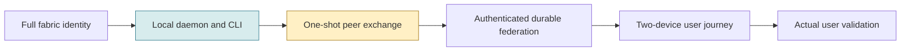

# Phenotype Fabric — State & Forward Docket, pilot baseline

**Snapshot:** PF-SFD-20261023-READ-001  | **Classification:** source-audited documentation snapshot, **NOT runtime acceptance**  
**Observed Git ref:** `73187462e6bc4202879374be60deb98e994b005a` (main at initial read)  | **Date:** 2026-10-23, America/Los_Angeles  
**Producer:** ChatGPT via authorized GitHub connector; no local checkout/physical host runtime access  
**Previous comparable snapshot:** none. **Progress scores:** NOT MEASURED; no denominator/accepted evidence baseline has been established.

## Two-minute decision brief

**Identity.** Phenotype Fabric's accepted specified identity is one coherent interactive computer across connected machines, sessions, execution placements, I/O and surfaces with cost-aware paths and real-time protection. This is vastly wider than today's daemon/CLI. Its own PRD identifies twelve jobs to be done and twelve epics. The existence of many crates is not evidence those outcomes can be completed by a beneficiary.

**What can be attempted now.** The existing source-backed first-run guide describes a loopback daemon/CLI status journey: `cargo build --workspace` then `cargo run -p fabric-daemon` in terminal A and `cargo run -p fabric-cli -- status` in terminal B. Source inspection confirms its route architecture; it was **not executed in this audit**. This is a developer inspection slice, not an identity-bearing multi-machine CVP.

**More recent than the guide.** A `federation_pair_request` wire handler and startup static-peers auto-pair path are implemented at the inspected ref; four loopback test functions are present. The request is raw TCP rather than a first-class CLI/GUI journey. The merged view is returned once but **not stored** for subsequent probe calls; inter-daemon caller authentication and real two-host proof are absent. The quickstart's old blanket “no shipped pairing procedure” statement was superseded by the newer acceptance document. It must not be repeated as current implementation truth.

**Immediate decision.** Prove the actual loopback daemon/CLI and pairing tests on a clean controlled host; then implement safe, authenticated, persistent two-device pairing as an end-to-end CVP candidate. Do not connect the current unauthenticated pair operation to an untrusted network.

**Critical unknowns.** Installed artifacts, current daemon/test execution, authenticated real-host pairing, retained topology, GUI delivery, non-TCP routes, low-latency performance under load, and owner-led use are **not verified** in this pilot.

## Status matrix

| Lane | Code/document state at pinned ref | Evidence class | Beneficiary status |
|---|---|---|---|
| Root Rust workspace | 23 members declared; Tauri shell explicitly excluded | Source read | Build not run here |
| Loopback daemon/CLI status | Source-described viable local developer path | Source + existing quickstart report | **NOT RUN** here |
| Federation one-shot | Wire handler, peer dialer and 4 named loopback tests exist | Source read; test presence only | Not a completed secure 2-device journey |
| Cross-host persistent pairing | No retained merged topology in described implementation | Code comments + acceptance doc | Not established |
| Authenticated peer trust | Outbound dial does not prove peer identity | Acceptance note; implementation design | Security release blocker |
| Non-TCP transports | UnsupportedTransport for non-TCP stages | Source implementation | Not shipped |
| GUI packaging | `crates/fabric-gui/src-tauri` excluded from root workspace | Cargo.toml | Separate build unverified |
| Full product CVP | Multi-machine useful continuous workspace | PRD intent, not demonstrated product outcome | Not accepted |

## Visual: intent is not deployed capability

**Interpretation:** source presence at B/C is not admission of D/E/F; no bar percentages are printed without an agreed, stable, evidence-backed denominator.

## Next 30 / 60 / 240 minutes

- **30 min target (provisional, resource-dependent):** reproduce source-described `fabric-daemon` status behavior on a host with Rust toolchain; store exact command, output, environment and SHA. This is a target, not a promised estimate.
- **60 min target:** run the four pairing integration tests on the pinned tree and record failure/success, plus check one-shot persistence behavior through a second probe. Do not promote test presence to passing status.
- **4 h candidate:** produce a positive/negative acceptance specification for safe two-host pairing, including unauthorized peer rejection, retention across queries, restart and rejoin; only implement after boundary/authority and credential policy are resolved.
- **24 h candidate:** isolate the minimal CVP, graph of dependencies and clean-room runner/distribution evidence. Time to mature full Fabric is **not estimable from these limited observations**.

## Scope and limits

This is a *real GitHub source audit*, not real runtime observation. The selected files and current Git ref are listed in [evidence](03-EVIDENCE.md). No credentials were accessed, no daemon was started, no hardware touched, no workload benchmarked, no agents or users were simulated, and no run/merge is claimed. It is not a universal portfolio score or a separate tracking authority. Existing specs/AgilePlus own execution; Tracera owns broader product evidence relationships.
