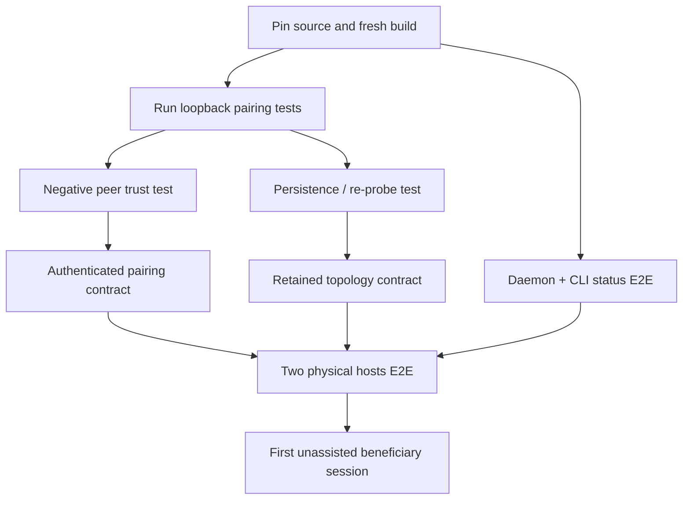

# Forward DAG, acceptance and reporting contract

**Baseline:** PF-SFD-20261023-READ-001. Estimates below are *unmeasured classes*, not deadlines.

## Dependency-backed work items

| ID | Outcome and positive/negative oracle | Dependencies | Authority | Estimate/stop rule |
|---|---|---|---|---|
| W01 | Pin SHA/env; Cargo workspace builds on target host | None | Local host access | UNKNOWN until environment/toolchain available |
| W02 | Actual daemon starts, CLI reports health; bad daemon is rejected | W01 | Local host | UNKNOWN |
| W03 | Run all four source-declared pairing tests, capture result and environment | W01 | Runner | UNKNOWN |
| W04 | Pair succeeds only with trusted peer identity; spoof/anonymous rejected | W03, approved auth model | Security/WorkOS policy | HUMAN-GATED; no insecure workaround |
| W05 | Merged graph visible in subsequent probe/restart; stale peer handled | W03 | Fabric coordinator owner | UNKNOWN |
| W06 | Resolve config listen key and auth-bootstrap semantics without security regression | W02, approved config contract | Fabric daemon owner | UNKNOWN |
| W07 | Fix/verify active connection capacity after repeated close/reconnect | W02 | Fabric daemon owner | UNKNOWN |
| W08 | Two real hosts: pair, inspect persistent topology, disconnect/rejoin | W04,W05,W06 | Hardware+permissions | External devices required |
| W09 | One actual useful cross-host beneficiary task | W08, accepted CVP | User feedback | Unknown wait |
| W10 | Benchmark latency/privacy/real-time under expected contention | W09 | Test lab | Hardware/instrumentation required |

These are task candidates, not registered AgilePlus work items. Actual owner assignments and specs remain unresolved. Do not divide effort by agent count or convert one-hour reporting cadence into a one-hour completion promise.

## Delta Tree contract

Hour 0 prints full selected goal/critical-gate tree and explicit unknown denominators. At hour N print only changed goal leaves/ancestors: new accepted engineering credit, complete usable journeys, evidence revocation, failure, baseline restatement, human decision. Include unique event ID, occurred/observed/ingested times, source SHA, affected leaf, old/new state and acceptance. Unknown source coverage is `NO_OBSERVATION`, not `NO_CHANGE`.

| Axis | Baseline admitted evidence | Movement from this documentation pilot |
|---|---|---|
| Raw engineering | Several code paths verified present in Git | **0 implementation delta** — documentation changes only |
| Verified engineering | No current executed test/consumer artifacts captured | **Unmeasured** |
| Usable full multi-host journey | No current physical host task captured | **Unmeasured / not demonstrated** |
| External/user validation | No participant observation captured | **None established** |
| Risk/documentation | Inconsistency G01 exposed and corrected in proposal | Source truth clarified, not consumer capability |

## Risk and release gates

Never merge/declare a full CVP while the peer can be spoofed, while merged state disappears across a second consumer query, or while no real two-host attempt has been independently verified. Any explicit CVP definition change requires accepted intent; optional scale features need actual deferral authority. Fork policy: PhenoFabric is evaluated as an original ecosystem product unless lineage evidence proves otherwise; no blanket upstream rebase target assumed.

## Real follow-up

Once runner/host access is available, record exact commands, outputs and negative cases in the existing assessment/evidence owner system, not new evidence stores. Update the generated PDF/MD projections from the resulting snapshot, then compare same-baseline outcomes across one hour and one day.
